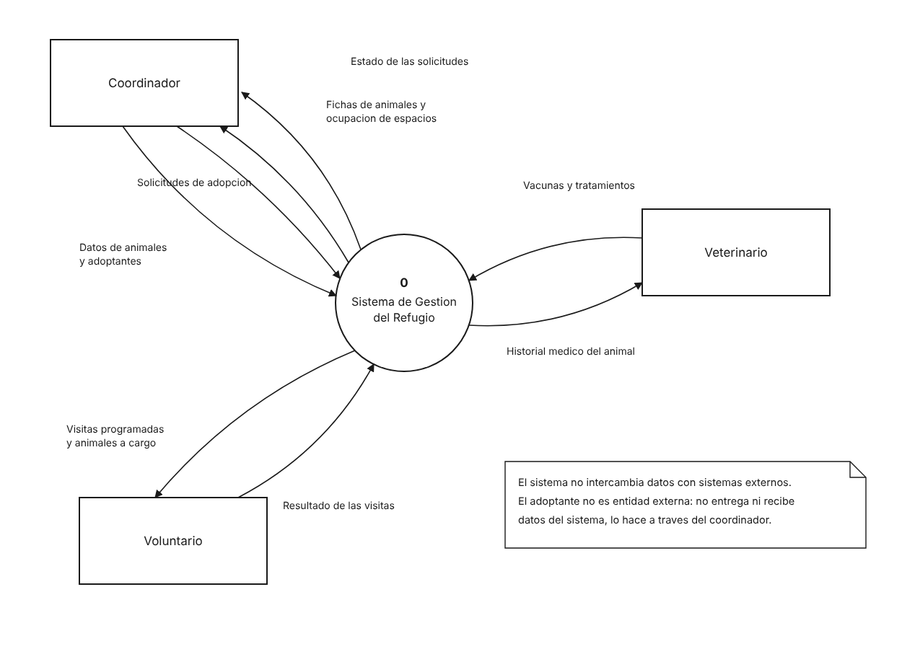
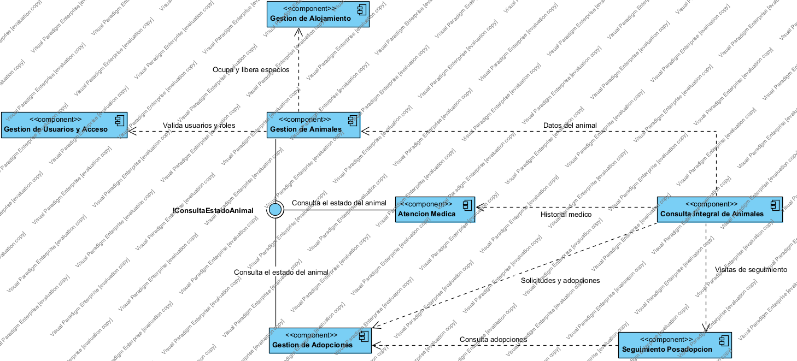
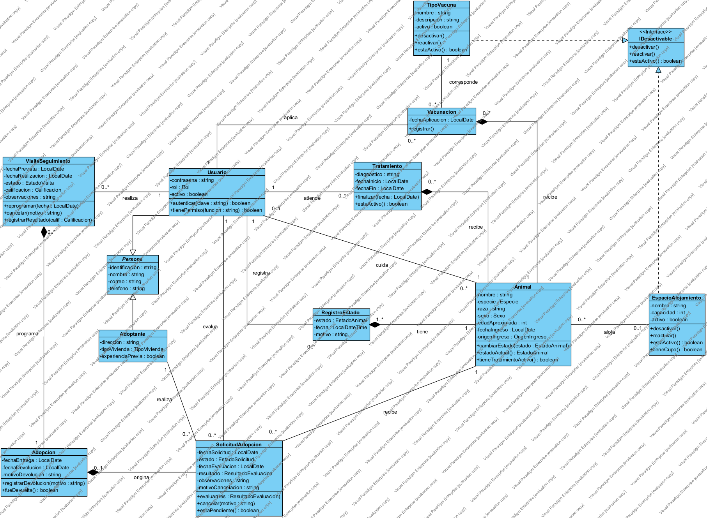

# Sistema de gestión para un centro de rescate y adopción de mascotas

Proyecto final de la asignatura de Diseño de Software.

## El problema

Los refugios de animales operan sin trazabilidad: no se sabe con certeza en qué estado se encuentra cada animal, quién lo atendió, cuántas solicitudes de adopción ha recibido ni qué ocurrió con él después de ser entregado. Esa falta de registro dificulta la operación diaria y favorece las adopciones fallidas.

## Qué cubre el sistema

El ciclo completo del animal dentro del refugio: el registro de su ingreso y el origen del rescate, su ubicación en los espacios de alojamiento, el control de su estado a lo largo del tiempo, el historial médico de vacunas y tratamientos, el proceso de adopción desde la solicitud hasta la entrega o la devolución, y las visitas de seguimiento posteriores.

## Roles

| Rol | Qué hace |
|---|---|
| Coordinador | Administra animales, espacios, adoptantes y el proceso de adopción completo, incluidas la evaluación de solicitudes, la entrega, la devolución y la programación de visitas |
| Veterinario | Registra vacunas y tratamientos y administra el catálogo de tipos de vacuna |
| Voluntario | Consulta los animales que tiene a cargo y registra el resultado de las visitas que se le programan |

El adoptante no opera el sistema: sus datos y sus solicitudes los registra el coordinador en su nombre.

## Fuera de alcance

Integraciones con sistemas externos, gestión de donaciones y pagos, y cualquier mecanismo de recomendación automática entre adoptante y animal.

## Documentación

| Documento | Contenido |
|---|---|
| [Requisitos](docs/requisitos.md) | 22 requisitos funcionales y 11 no funcionales con métrica, con la trazabilidad hacia cada historia |
| [Historias de usuario](docs/historias/) | 21 historias con validación INVEST y criterios de aceptación en Gherkin |
| [Vista de contexto](docs/vista-contexto.md) | Frontera del sistema: entidades externas y flujos de datos |
| [Vista funcional](docs/vista-funcional.md) | Siete componentes, sus dependencias y la interfaz que comparten |
| [Vista lógica](docs/vista-logica.md) | Doce clases, una interfaz, relaciones y multiplicidades |
| [Decisiones de diseño](docs/decisiones-de-diseno.md) | Qué se decidió, por qué, y qué alternativa se descartó |

El backlog está publicado como [issues](../../issues), uno por historia, etiquetados por componente y agrupados en hitos según el orden de implementación.

## Diagramas

### Vista de contexto

### Vista funcional

### Vista lógica

