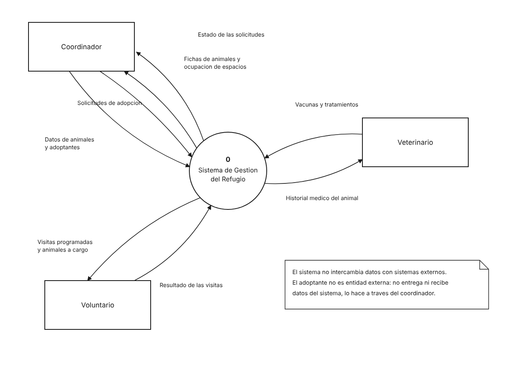

# Vista de contexto

Diagrama de contexto de flujo de datos. Delimita la frontera del sistema: quién intercambia información con él y qué información es. El sistema se representa como un único proceso, sin detallar su interior.

## Proceso

| Nº | Proceso |
|---|---|
| 0 | Sistema de Gestión del Refugio |

## Entidades externas

| Entidad | Quién es | Historias en las que actúa |
|---|---|---|
| Coordinador | Rol administrativo del refugio. Registra animales, adoptantes y el proceso de adopción completo. | HU-01, HU-03 a HU-06, HU-12 a HU-18, HU-20, HU-21 |
| Veterinario | Responsable de la atención médica de los animales. | HU-04, HU-09, HU-10, HU-11 |
| Voluntario | Cuida animales asignados y realiza las visitas de seguimiento. | HU-19 |

## Flujos de datos

| Nº | Origen | Destino | Flujo |
|---|---|---|---|
| 1 | Coordinador | Sistema | Datos de animales y adoptantes |
| 2 | Coordinador | Sistema | Solicitudes de adopción |
| 3 | Sistema | Coordinador | Fichas de animales y ocupación de espacios |
| 4 | Sistema | Coordinador | Estado de las solicitudes |
| 5 | Veterinario | Sistema | Vacunas y tratamientos |
| 6 | Sistema | Veterinario | Historial médico del animal |
| 7 | Voluntario | Sistema | Resultado de las visitas |
| 8 | Sistema | Voluntario | Visitas programadas y animales a cargo |

## Decisiones de esta vista

**No hay entidades externas de software.** El alcance excluye integraciones con terceros: no hay correo, pasarela de pagos, ni conexión con entidades veterinarias o municipales. Un diagrama de contexto sin sistemas externos es un resultado válido, no un diagrama incompleto.

**El adoptante no es una entidad externa.** Es el beneficiario del proceso, pero no entrega ni recibe datos directamente del sistema: sus datos los registra el coordinador (HU-12) y sus solicitudes también (HU-13). Una entidad externa en un diagrama de contexto es la que intercambia datos con el sistema, y el adoptante no lo hace.

**No aparecen almacenes de datos.** Los almacenes pertenecen al nivel 1 de descomposición, no al diagrama de contexto.

## Notación

Diagrama de flujo de datos. El proceso se dibuja como un círculo numerado (notación Yourdon) o como rectángulo redondeado con franja de identificador (notación Gane-Sarson); ambas son válidas mientras se use una sola de forma consistente. Las entidades externas son rectángulos y los flujos son flechas dirigidas con nombre. Cada sentido lleva su propia flecha, porque la información que entra y la que sale son distintas.
