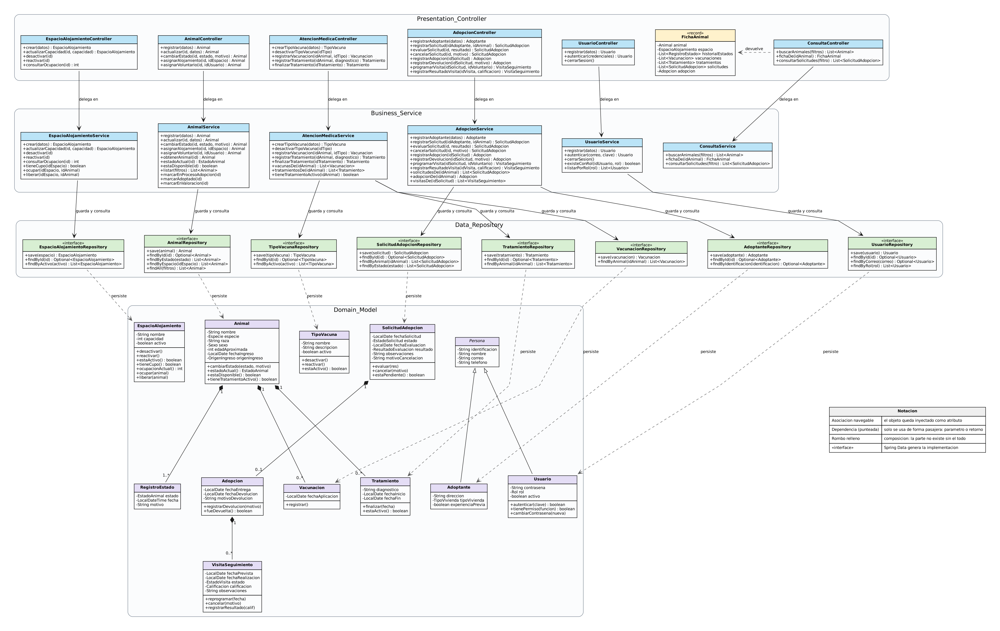

# Vista de desarrollo

Diagrama de clases organizado por capas. Muestra cómo se estructura el código que implementa el sistema: qué clase recibe la petición, cuál aplica las reglas y cuál habla con la base de datos. No describe el reparto de responsabilidades funcionales (eso es la [vista funcional](vista-funcional.md)) ni la estructura del dominio (eso es la [vista lógica](vista-logica.md)).

## 1. Las tres capas

| Capa | Marco en el diagrama | Responsabilidad | Sufijo |
|---|---|---|---|
| Presentación | `Presentation_Controller` | Recibir la petición HTTP, validar el formato básico de la entrada y devolver la respuesta con su código de estado | `…Controller` |
| Negocio | `Business_Service` | Coordinar el caso de uso y hacer cumplir las reglas del dominio | `…Service` |
| Datos | `Data_Repository` | Guardar y recuperar documentos de MongoDB | `…Repository` |

El cuarto marco, `Domain_Model`, contiene las clases de la vista lógica. **No es una cuarta capa de ejecución**: es el modelo de dominio que las tres capas comparten. Ninguna petición "pasa por" el modelo de dominio; las tres capas lo usan como tipo de sus parámetros y de sus retornos.

La dirección de las dependencias es siempre hacia abajo: Presentación conoce a Negocio, Negocio conoce a Datos, y ninguna capa conoce a la que está encima.

## 2. Notación

Es la distinción que plantea la lectura del bloque 7: si una clase **conserva** una referencia a otra, se dibuja una asociación; si solo la **usa de paso**, basta una dependencia.

| Relación | Trazo | Cuándo se usa | Ejemplo |
|---|---|---|---|
| Asociación navegable | Línea continua, flecha abierta | El objeto se inyecta en el constructor y queda como atributo durante toda la vida de la clase | `AnimalController → AnimalService` |
| Dependencia | Línea punteada, flecha abierta | El tipo solo aparece como parámetro o como retorno de un método | `AnimalRepository ⇢ Animal` |
| Generalización | Línea continua, triángulo hueco | Herencia dentro del modelo de dominio | `Usuario ▷ Persona` |
| Composición | Línea continua, rombo relleno en el todo | La parte no existe sin el todo | `Animal ◆ RegistroEstado` |

Los repositorios se dibujan como `«interface»` porque en Spring Data el programador declara la interfaz y el framework genera la implementación en tiempo de ejecución. Por eso tampoco aparece una clase `…RepositoryImpl`.

Las dependencias `Service ⇢ entidad` («crea y devuelve») existen en el modelo y están en el XMI, pero no se dibujan en la imagen: cruzarían el lienzo entero y lo volverían ilegible. Quedan documentadas en la tabla 3.

## 3. Correspondencia con las vistas anteriores

Hay **un Controller y un Service por cada componente de la vista funcional**. Así la vista de desarrollo no inventa una estructura nueva: traduce a código el reparto que ya quedó fijado en la vista funcional.

| Componente (vista funcional) | Controller | Service | Repositorios que usa | Entidades que maneja | Historias |
|---|---|---|---|---|---|
| Gestión de Usuarios y Acceso | `UsuarioController` | `UsuarioService` | `UsuarioRepository` | `Persona`, `Usuario` | HU-01, HU-02 |
| Gestión de Alojamiento | `EspacioAlojamientoController` | `EspacioAlojamientoService` | `EspacioAlojamientoRepository` | `EspacioAlojamiento` | HU-06 |
| Gestión de Animales | `AnimalController` | `AnimalService` | `AnimalRepository` | `Animal`, `RegistroEstado` | HU-03, HU-04, HU-05, HU-21 |
| Atención Médica | `AtencionMedicaController` | `AtencionMedicaService` | `TipoVacunaRepository`, `VacunacionRepository`, `TratamientoRepository` | `TipoVacuna`, `Vacunacion`, `Tratamiento` | HU-09, HU-10, HU-11 |
| Gestión de Adopciones | `AdopcionController` | `AdopcionService` | `AdoptanteRepository`, `SolicitudAdopcionRepository` | `Adoptante`, `SolicitudAdopcion`, `Adopcion`, `VisitaSeguimiento` | HU-12 a HU-20 |
| Consultas y Reportes | `ConsultaController` | `ConsultaService` | ninguno propio | — | HU-07, HU-08 |

`ConsultaService` **no tiene repositorio propio**, igual que el componente Consultas y Reportes no tiene clases propias en la vista funcional. Obtiene todo a través de los otros services, respetando sus reglas en lugar de leer las colecciones por su cuenta.

## 4. Colaboración entre services

Son exactamente las ocho conexiones de ensamblaje de la vista funcional, trasladadas a la capa de negocio. Se presentan en tabla y no como líneas en el diagrama para que las tres capas se sigan leyendo de arriba abajo.

| Service que pide | Service que responde | Interfaz de la vista funcional | Para qué |
|---|---|---|---|
| `ConsultaService` | `AnimalService` | `IConsultaAnimal` | Obtener el animal y su estado para la ficha integral |
| `ConsultaService` | `AtencionMedicaService` | `IHistorialMedico` | Añadir vacunas y tratamientos a la ficha |
| `ConsultaService` | `AdopcionService` | `IConsultaAdopciones` | Añadir solicitudes y adopción a la ficha |
| `AtencionMedicaService` | `AnimalService` | `IConsultaAnimal` | Verificar que el animal existe antes de registrar vacuna o tratamiento |
| `AdopcionService` | `AnimalService` | `IConsultaAnimal` | Verificar que el animal está disponible antes de aceptar la solicitud |
| `AdopcionService` | `AnimalService` | `ITransicionEstado` | Mover el animal a *en proceso*, *adoptado* o *en valoración* |
| `AnimalService` | `EspacioAlojamientoService` | `IEspacios` | Comprobar cupo, ocupar y liberar al alojar o adoptar |
| `AnimalService` | `UsuarioService` | `IConsultaUsuario` | Verificar que el usuario asignado tenga el rol de voluntario |

## 5. Colecciones de MongoDB

MongoDB no tiene tablas ni claves foráneas: la decisión de diseño es **qué se incrusta dentro de un documento y qué vive en su propia colección**. El criterio aplicado es la composición de la vista lógica *más* la frontera del componente que la posee.

| Colección | Documento raíz | Incrusta | Repositorio |
|---|---|---|---|
| `usuarios` | `Usuario` | — | `UsuarioRepository` |
| `adoptantes` | `Adoptante` | — | `AdoptanteRepository` |
| `espacios` | `EspacioAlojamiento` | — | `EspacioAlojamientoRepository` |
| `animales` | `Animal` | `RegistroEstado` | `AnimalRepository` |
| `tiposVacuna` | `TipoVacuna` | — | `TipoVacunaRepository` |
| `vacunaciones` | `Vacunacion` | — | `VacunacionRepository` |
| `tratamientos` | `Tratamiento` | — | `TratamientoRepository` |
| `solicitudes` | `SolicitudAdopcion` | `Adopcion`, y dentro de ella `VisitaSeguimiento` | `SolicitudAdopcionRepository` |

Las cinco composiciones de la vista lógica se resuelven de dos maneras distintas:

- Cuando el todo y la parte **pertenecen al mismo componente**, la parte se incrusta. `RegistroEstado` vive dentro de `animales`, y `Adopcion` y `VisitaSeguimiento` dentro de `solicitudes`. Nadie fuera del componente necesita leerlas por separado y así se borran automáticamente con su documento padre.
- Cuando la composición **cruza la frontera de un componente**, la parte va a su propia colección con una referencia al identificador del animal. Es el caso de `Vacunacion` y `Tratamiento`: son partes de `Animal`, pero las posee Atención Médica. Incrustarlas obligaría a Atención Médica a escribir dentro de los documentos de Gestión de Animales, lo que rompería el encapsulamiento que establece la vista funcional.

En este segundo caso la composición sigue siendo cierta en el dominio: si se elimina un animal, `AnimalService` debe eliminar sus vacunaciones y tratamientos. La diferencia es que esa regla la hace cumplir el service, no el motor de base de datos.

## 6. Endpoints REST

Cada operación de la fachada pública se expone como un endpoint. Las transiciones de estado se modelan como una acción sobre un subrecurso (`POST`) y no como una edición del campo (`PATCH`), porque cada transición tiene reglas propias.

| Método | Ruta | Controller.método | Interfaz pública | Rol | Historia |
|---|---|---|---|---|---|
| `POST` | `/api/usuarios` | `UsuarioController.registrar` | `IAccesoUsuarios` | Coordinador | HU-01 |
| `POST` | `/api/sesiones` | `UsuarioController.autenticar` | `IAccesoUsuarios` | Todos | HU-02 |
| `DELETE` | `/api/sesiones/actual` | `UsuarioController.cerrarSesion` | `IAccesoUsuarios` | Todos | HU-02 |
| `POST` | `/api/espacios` | `EspacioAlojamientoController.crear` | `IAdministracionEspacios` | Coordinador | HU-06 |
| `PATCH` | `/api/espacios/{id}` | `EspacioAlojamientoController.actualizarCapacidad` | `IAdministracionEspacios` | Coordinador | HU-06 |
| `POST` | `/api/espacios/{id}/desactivacion` | `EspacioAlojamientoController.desactivar` | `IAdministracionEspacios` | Coordinador | HU-06 |
| `POST` | `/api/espacios/{id}/reactivacion` | `EspacioAlojamientoController.reactivar` | `IAdministracionEspacios` | Coordinador | HU-06 |
| `GET` | `/api/espacios/{id}/ocupacion` | `EspacioAlojamientoController.consultarOcupacion` | `IAdministracionEspacios` | Coordinador | HU-06 |
| `POST` | `/api/animales` | `AnimalController.registrar` | `IGestionAnimales` | Coordinador | HU-03 |
| `PUT` | `/api/animales/{id}` | `AnimalController.actualizar` | `IGestionAnimales` | Coordinador | HU-03 |
| `POST` | `/api/animales/{id}/estados` | `AnimalController.cambiarEstado` | `IGestionAnimales` | Coordinador | HU-04 |
| `POST` | `/api/animales/{id}/alojamiento` | `AnimalController.asignarAlojamiento` | `IGestionAnimales` | Coordinador | HU-05 |
| `POST` | `/api/animales/{id}/responsable` | `AnimalController.asignarVoluntario` | `IGestionAnimales` | Coordinador | HU-21 |
| `POST` | `/api/tipos-vacuna` | `AtencionMedicaController.crearTipoVacuna` | `IAtencionMedica` | Veterinario | HU-09 |
| `POST` | `/api/tipos-vacuna/{id}/desactivacion` | `AtencionMedicaController.desactivarTipoVacuna` | `IAtencionMedica` | Veterinario | HU-09 |
| `POST` | `/api/animales/{id}/vacunaciones` | `AtencionMedicaController.registrarVacunacion` | `IAtencionMedica` | Veterinario | HU-10 |
| `POST` | `/api/animales/{id}/tratamientos` | `AtencionMedicaController.registrarTratamiento` | `IAtencionMedica` | Veterinario | HU-11 |
| `POST` | `/api/tratamientos/{id}/finalizacion` | `AtencionMedicaController.finalizarTratamiento` | `IAtencionMedica` | Veterinario | HU-11 |
| `POST` | `/api/adoptantes` | `AdopcionController.registrarAdoptante` | `IGestionAdopciones` | Coordinador | HU-12 |
| `POST` | `/api/solicitudes` | `AdopcionController.registrarSolicitud` | `IGestionAdopciones` | Coordinador | HU-13 |
| `POST` | `/api/solicitudes/{id}/evaluacion` | `AdopcionController.evaluarSolicitud` | `IGestionAdopciones` | Coordinador | HU-14 |
| `POST` | `/api/solicitudes/{id}/cancelacion` | `AdopcionController.cancelarSolicitud` | `IGestionAdopciones` | Coordinador | HU-15 |
| `POST` | `/api/solicitudes/{id}/adopcion` | `AdopcionController.registrarAdopcion` | `IGestionAdopciones` | Coordinador | HU-17 |
| `POST` | `/api/solicitudes/{id}/devolucion` | `AdopcionController.registrarDevolucion` | `IGestionAdopciones` | Coordinador | HU-20 |
| `POST` | `/api/solicitudes/{id}/visitas` | `AdopcionController.programarVisita` | `IGestionAdopciones` | Coordinador | HU-18 |
| `POST` | `/api/visitas/{id}/resultado` | `AdopcionController.registrarResultadoVisita` | `IGestionAdopciones` | Voluntario | HU-19 |
| `GET` | `/api/animales` | `ConsultaController.buscarAnimales` | `IConsultas` | Todos | HU-07 |
| `GET` | `/api/animales/{id}/ficha` | `ConsultaController.fichaDe` | `IConsultas` | Coordinador, Veterinario | HU-08 |
| `GET` | `/api/solicitudes` | `ConsultaController.consultarSolicitudes` | `IConsultas` | Coordinador | HU-16 |

Códigos de respuesta previstos: `200` para consultas y actualizaciones, `201` para creaciones, `204` para el cierre de sesión, `400` cuando la entrada está mal formada, `404` cuando el recurso no existe, `409` cuando la operación contradice una regla del dominio (adoptar un animal no disponible, alojar en un espacio sin cupo) y `500` para fallos no previstos.

## 7. `FichaAnimal`: el único objeto que no es entidad

`fichaDe` devuelve información de cuatro componentes a la vez: el animal, su espacio, su historial médico y sus solicitudes. No existe ninguna entidad del dominio que corresponda a eso, y crearla sería inventar una clase que no tiene identidad ni ciclo de vida propios.

Por eso `FichaAnimal` se declara como `«record»` en la capa de presentación: es un objeto de transferencia que `ConsultaService` arma pidiendo las partes a los demás services. Esto explica por qué el componente Consultas y Reportes aparece sin clases propias en la vista funcional: su salida es un DTO, no una entidad.

## 8. Clases transversales

No pertenecen a ninguna de las tres capas; las atraviesan. Se nombran aquí y no se dibujan en el diagrama para no competir con la estructura principal.

| Clase | Qué hace |
|---|---|
| `SecurityConfig` | Define qué rol puede llamar a cada ruta, según la columna Rol de la tabla 6 |
| `GlobalExceptionHandler` | Traduce las excepciones del dominio a los códigos `400`, `404` y `409` |
| `MongoConfig` | Conexión a la base de datos y conversores de los tipos de fecha |

## 9. Pendientes

- La paginación de `GET /api/animales` y `GET /api/solicitudes` no está definida. Con el volumen de un refugio pequeño puede esperar, pero debería resolverse antes de implementar.
- El formato de los filtros de `buscarAnimales` (parámetros de consulta sueltos o un objeto de criterios) está sin decidir.
