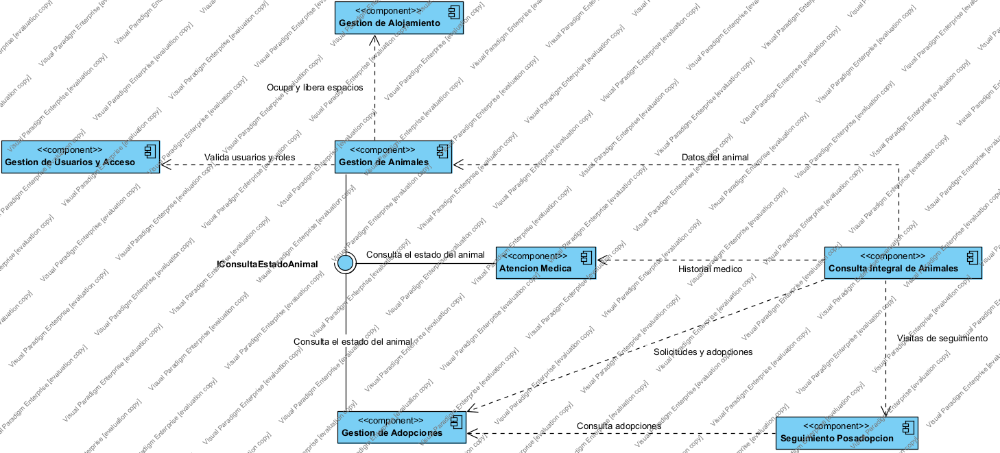

# Vista funcional

Diagrama de componentes UML. Agrupa las funcionalidades del sistema en componentes con responsabilidades diferenciadas y muestra cómo colaboran entre sí. No describe clases ni despliegue.

## Componentes

La columna **Clases** enlaza esta vista con la [vista lógica](vista-logica.md); la columna **Historias**, con el backlog.

| Componente | Responsabilidad | Clases | Historias |
|---|---|---|---|
| Gestión de Usuarios y Acceso | Administrar las cuentas del equipo y controlar qué puede hacer cada rol | `Persona`, `Usuario` | HU-01, HU-02 |
| Gestión de Animales | Mantener los datos del animal, su estado, su ubicación y su cuidador responsable | `Animal`, `RegistroEstado` | HU-03, HU-04, HU-05, HU-21 |
| Gestión de Alojamiento | Administrar los espacios del refugio y su capacidad disponible | `EspacioAlojamiento` | HU-06 |
| Atención Médica | Llevar el catálogo de vacunas y el historial sanitario de cada animal | `TipoVacuna`, `Vacunacion`, `Tratamiento` | HU-09, HU-10, HU-11 |
| Gestión de Adopciones | Conducir el proceso completo, desde el adoptante hasta la entrega o la devolución | `Adoptante`, `SolicitudAdopcion`, `Adopcion` | HU-12 a HU-17, HU-20 |
| Seguimiento Posadopción | Programar y registrar las visitas posteriores a la entrega | `VisitaSeguimiento` | HU-18, HU-19 |
| Consulta Integral de Animales | Consolidar y presentar la información completa de un animal | — | HU-07, HU-08 |

## Interfaz

| Interfaz | La proporciona | La requieren | Operaciones |
|---|---|---|---|
| `IConsultaEstadoAnimal` | Gestión de Animales | Atención Médica, Gestión de Adopciones | `estadoActual(idAnimal) : EstadoAnimal`, `estaDisponible(idAnimal) : boolean` |

Se modeló como interfaz y no como dos dependencias sueltas porque es un mismo contrato consumido por dos clientes distintos: Atención Médica la necesita para no registrar vacunas a un animal *No disponible* y Gestión de Adopciones para no aceptar solicitudes sobre un animal que no esté *Disponible*.

## Dependencias

| Cliente | Proveedor | Qué necesita |
|---|---|---|
| Seguimiento Posadopción | Gestión de Adopciones | Las visitas se programan sobre una adopción registrada y se cancelan ante una devolución |
| Gestión de Animales | Gestión de Alojamiento | Consultar el cupo disponible y ocupar o liberar un espacio |
| Gestión de Animales | Gestión de Usuarios y Acceso | Validar que el voluntario asignado como responsable exista y tenga ese rol |
| Consulta Integral de Animales | Gestión de Animales | Datos del animal y su estado actual |
| Consulta Integral de Animales | Atención Médica | Historial de vacunas y tratamientos |
| Consulta Integral de Animales | Gestión de Adopciones | Solicitudes y adopciones del animal |
| Consulta Integral de Animales | Seguimiento Posadopción | Visitas de seguimiento y sus resultados |

Todos los componentes obtienen de Gestión de Usuarios y Acceso la identidad y los permisos del usuario de la sesión. Esa dependencia es transversal y no se dibuja como línea desde cada componente; queda registrada como nota en el diagrama.

## Decisiones de esta vista

**Consulta Integral de Animales existe para evitar dependencias circulares.** La ficha integral de HU-08 consolida información de cuatro componentes. Si esa responsabilidad viviera dentro de Gestión de Animales, ese componente tendría que depender de Atención Médica, Gestión de Adopciones y Seguimiento Posadopción, mientras que los tres ya dependen de él para consultar el estado del animal. Separar la consulta en un componente que solo consume y nunca es consumido elimina los tres ciclos sin aumentar el número de dependencias.

**La asignación de la ubicación vive en Gestión de Animales, no en Gestión de Alojamiento.** Si Alojamiento asignara el animal a un espacio necesitaría consultar su estado, y Animales necesitaría avisarle para liberar el espacio al adoptarse: dependencia en ambos sentidos. Dejando la asignación en Animales, Alojamiento solo conoce espacios y cupos.

**Gestión de Alojamiento se mantiene separada pese a tener una sola clase.** Su responsabilidad, administrar espacios y capacidad, es distinta de la del animal. Fusionarla con Gestión de Animales dejaría a ese componente gestionando dos conceptos sin relación directa.

**No existe un componente de interfaz de usuario ni de persistencia.** El alcance de esta vista es la distribución de responsabilidades funcionales; la capa de presentación y el almacenamiento son decisiones de las vistas de desarrollo y despliegue.

## Notación

Diagrama de componentes UML. Cada componente es un rectángulo con el estereotipo `«component»`. Las dependencias se dibujan con línea discontinua y flecha abierta apuntando al proveedor, y llevan en su nombre lo que el cliente necesita. La interfaz proporcionada se dibuja con el círculo pegado al componente que la ofrece y las requeridas con el semicírculo de cada consumidor. No hay multiplicidades: no corresponden a esta vista.
