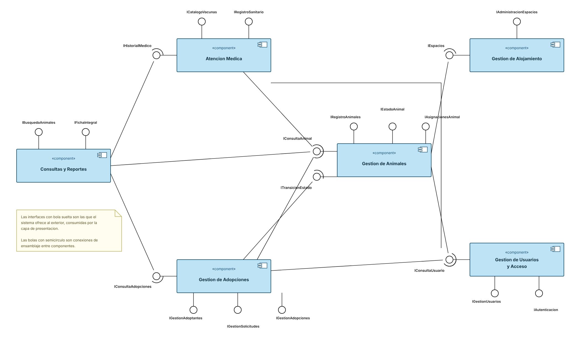

# Vista funcional

Diagrama de componentes UML. Agrupa las funcionalidades del sistema en componentes con responsabilidades diferenciadas y expresa su colaboración mediante interfaces proporcionadas y requeridas. No describe clases ni despliegue.

## Componentes

La columna **Clases** enlaza esta vista con la [vista lógica](vista-logica.md); la columna **Historias**, con el backlog.

| Componente | Responsabilidad | Clases | Historias |
|---|---|---|---|
| Gestión de Usuarios y Acceso | Administrar las cuentas del equipo y controlar qué puede hacer cada rol | `Persona`, `Usuario` | HU-01, HU-02 |
| Gestión de Alojamiento | Administrar los espacios del refugio y su capacidad disponible | `EspacioAlojamiento` | HU-06 |
| Gestión de Animales | Mantener los datos del animal, su estado, su ubicación y su cuidador responsable | `Animal`, `RegistroEstado` | HU-03, HU-04, HU-05, HU-21 |
| Atención Médica | Llevar el catálogo de vacunas y el historial sanitario de cada animal | `TipoVacuna`, `Vacunacion`, `Tratamiento` | HU-09, HU-10, HU-11 |
| Gestión de Adopciones | Conducir el proceso completo: adoptante, solicitud, entrega, devolución y visitas de seguimiento | `Adoptante`, `SolicitudAdopcion`, `Adopcion`, `VisitaSeguimiento` | HU-12 a HU-20 |
| Consultas y Reportes | Consolidar y presentar información que proviene de varios componentes | — | HU-07, HU-08 |

## Interfaces públicas

Cada componente ofrece **una sola** fachada hacia la capa de presentación. En el diagrama se dibujan como bola sin semicírculo.

| Interfaz | La proporciona | Operaciones | Historias |
|---|---|---|---|
| `IAccesoUsuarios` | Gestión de Usuarios y Acceso | `registrarUsuario`, `autenticar`, `cerrarSesion` | HU-01, HU-02 |
| `IAdministracionEspacios` | Gestión de Alojamiento | `crearEspacio`, `actualizarCapacidad`, `desactivarEspacio`, `reactivarEspacio`, `consultarOcupacion` | HU-06 |
| `IGestionAnimales` | Gestión de Animales | `registrarAnimal`, `actualizarAnimal`, `cambiarEstado`, `asignarAlojamiento`, `asignarVoluntario` | HU-03, HU-04, HU-05, HU-21 |
| `IAtencionMedica` | Atención Médica | `crearTipoVacuna`, `desactivarTipoVacuna`, `registrarVacunacion`, `registrarTratamiento`, `finalizarTratamiento` | HU-09, HU-10, HU-11 |
| `IGestionAdopciones` | Gestión de Adopciones | `registrarAdoptante`, `registrarSolicitud`, `evaluarSolicitud`, `cancelarSolicitud`, `registrarAdopcion`, `registrarDevolucion`, `programarVisita`, `registrarResultadoVisita` | HU-12 a HU-20 |
| `IConsultas` | Consultas y Reportes | `buscarAnimales`, `fichaDe`, `consultarSolicitudes` | HU-07, HU-08 |

## Interfaces internas y conexiones de ensamblaje

Son los contratos entre componentes. En el diagrama cada una se dibuja con una sola bola en el proveedor y tantos semicírculos como consumidores tenga.

| Interfaz | La proporciona | La requieren | Operaciones | Por qué se necesita |
|---|---|---|---|---|
| `IConsultaUsuario` | Gestión de Usuarios y Acceso | Gestión de Animales | `existeConRol`, `listarPorRol` | Al asignar el cuidador de un animal hay que ofrecer la lista de voluntarios y verificar que el elegido tenga ese rol |
| `IEspacios` | Gestión de Alojamiento | Gestión de Animales | `tieneCupo`, `ocupar`, `liberar` | Comprobar el cupo antes de alojar un animal y liberar el espacio al adoptarse |
| `IConsultaAnimal` | Gestión de Animales | Atención Médica, Gestión de Adopciones, Consultas y Reportes | `obtenerAnimal`, `estadoActual`, `estaDisponible`, `listar` | Atención Médica no vacuna a un animal *No disponible*; Adopciones no acepta solicitudes sobre uno que no esté *Disponible*; Consultas arma la ficha |
| `ITransicionEstado` | Gestión de Animales | Gestión de Adopciones | `marcarEnProcesoAdopcion`, `marcarAdoptado`, `marcarEnValoracion` | Los cambios de estado automáticos al aprobar, entregar o recibir una devolución |
| `IHistorialMedico` | Atención Médica | Consultas y Reportes | `vacunasDe`, `tratamientosDe`, `tieneTratamientoActivo` | La ficha integral muestra el historial sanitario |
| `IConsultaAdopciones` | Gestión de Adopciones | Consultas y Reportes | `solicitudesDe`, `adopcionDe`, `visitasDe` | La ficha integral muestra solicitudes, adopción y visitas |

Son seis interfaces internas y ocho conexiones de ensamblaje. En total, doce interfaces: seis fachadas públicas y seis contratos internos.

### Nombre de cada conexión

Cada conexión de ensamblaje lleva su nombre sobre la línea, igual que las interfaces. El nombre dice para qué la usa el cliente, no qué hace el proveedor.

| # | Cliente | Interfaz | Nombre de la conexión |
|---|---|---|---|
| 1 | Consultas y Reportes | `IHistorialMedico` | obtiene el historial médico |
| 2 | Consultas y Reportes | `IConsultaAdopciones` | obtiene solicitudes y visitas |
| 3 | Consultas y Reportes | `IConsultaAnimal` | obtiene los datos del animal |
| 4 | Atención Médica | `IConsultaAnimal` | verifica el estado antes de vacunar |
| 5 | Gestión de Adopciones | `IConsultaAnimal` | verifica que el animal esté disponible |
| 6 | Gestión de Adopciones | `ITransicionEstado` | solicita el cambio de estado automático |
| 7 | Gestión de Animales | `IEspacios` | verifica cupo y ocupa espacio |
| 8 | Gestión de Animales | `IConsultaUsuario` | valida el rol del voluntario |

Las conexiones 3, 4 y 5 comparten la misma interfaz, así que comparten una sola bola: las tres líneas llegan a un tronco común y de ahí sale un único semicírculo. Dibujar tres bolas con el mismo nombre significaría que Gestión de Animales realiza tres veces el mismo contrato.

## Decisiones de esta vista

**Toda colaboración se expresa como interfaz, no como dependencia.** Una dependencia dice que un componente necesita a otro; una interfaz dice *qué* le pide y con qué firma. Esto último es lo que permite reemplazar la implementación de un componente sin tocar a sus clientes. En el diagrama no hay ninguna flecha discontinua de dependencia.

**Seguimiento Posadopción se fusionó dentro de Gestión de Adopciones.** Tenía una sola clase, dos historias y su única colaboración era con Adopciones. Las visitas de seguimiento son parte del ciclo de vida de la adopción, no una responsabilidad separada.

**Consultas y Reportes se mantiene como componente propio y no dentro de Atención Médica.** La ficha integral consolida cinco cosas: estado del animal, alojamiento, historial médico, solicitudes y visitas. Si viviera dentro de Atención Médica, ese componente tendría que depender de Gestión de Adopciones, lo que mezcla la responsabilidad sanitaria con la del proceso de adopción. Como componente de solo lectura, consume de tres y no es consumido por nadie.

**Una sola fachada pública por componente.** La primera versión de esta vista tenía trece interfaces públicas, una por cada grupo de historias. Eso no aportaba información de diseño: era el backlog reescrito en forma de interfaz. El criterio que se aplicó para depurarlas fue segregar por tipo de cliente, no por caso de uso: la capa de presentación es un único cliente de cada componente, así que recibe una fachada; los componentes internos reciben un contrato propio solo cuando lo que necesitan es distinto.

**`IConsultaAnimal` e `ITransicionEstado` están separadas a propósito.** Ambas las proporciona Gestión de Animales, pero tienen clientes con derechos distintos: la primera solo lee y la consumen tres componentes, la segunda modifica el estado y solo la consume Gestión de Adopciones. Si fueran una sola interfaz, Consultas y Reportes, que es de solo lectura, quedaría con la capacidad de cambiar el estado de un animal.

**La identidad del usuario de la sesión no se dibuja.** Atención Médica y Gestión de Adopciones registran quién aplicó una vacuna o quién evaluó una solicitud, pero ese dato viene del contexto de la sesión, no de una consulta a otro componente. Dibujarlo habría sumado dos conexiones que no representan una colaboración real. El único caso en que sí hay consulta es la asignación del voluntario responsable, donde hay que ofrecer la lista de usuarios con ese rol.

**No hay dependencias circulares.** El grafo es un orden estricto: Gestión de Usuarios y Acceso y Gestión de Alojamiento no requieren nada; Gestión de Animales requiere de esas dos; Atención Médica y Gestión de Adopciones requieren de Gestión de Animales; Consultas y Reportes requiere de los tres anteriores. Eso es lo que se perdería si la ficha integral viviera dentro de Gestión de Animales: ese componente pasaría a requerir de quienes ya lo requieren a él.

**No existe un componente de interfaz de usuario ni de persistencia.** El alcance de esta vista es la distribución de responsabilidades funcionales; la capa de presentación y el almacenamiento corresponden a la vista de desarrollo y a la de despliegue.

## Notación

Diagrama de componentes UML. Cada componente es un rectángulo con el estereotipo «component» y el icono de componente. Una interfaz proporcionada se dibuja con la bola unida al componente que la ofrece; una requerida, con el semicírculo que la abraza por el lado del consumidor. Las conexiones de ensamblaje son líneas sólidas sin punta de flecha: no indican dirección de navegación sino que un componente usa el contrato que otro ofrece. El trazado es ortogonal, con quiebres en ángulo recto y sin líneas superpuestas. No se usan dependencias ni multiplicidades: no corresponden a esta vista.
