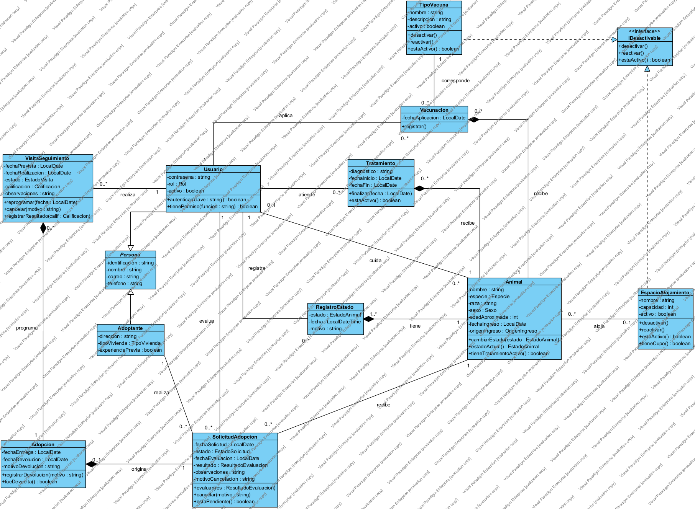

# Vista lógica

Diagrama de clases. Especifica las clases que implementan las responsabilidades de la [vista funcional](vista-funcional.md), con sus atributos, operaciones y relaciones.

Notación: `-` privado, `+` público. Las clases abstractas van en cursiva. Se omiten los constructores y los métodos `get` y `set`: cada atributo privado tiene los suyos.

## 1. Personas

### Persona `{abstract}`

| Atributos | Operaciones |
|---|---|
| `-identificacion : String` | — |
| `-nombre : String` | |
| `-correo : String` | |
| `-telefono : String` | |

### Usuario — hereda de `Persona`

| Atributos | Operaciones |
|---|---|
| `-contrasena : String` | `+autenticar(clave : String) : boolean` |
| `-rol : Rol` | `+tienePermiso(funcion : String) : boolean` |
| `-activo : boolean` | |

### Adoptante — hereda de `Persona`

| Atributos | Operaciones |
|---|---|
| `-direccion : String` | — |
| `-tipoVivienda : TipoVivienda` | |
| `-experienciaPrevia : boolean` | |

## 2. Animal y su historial

### Animal

| Atributos | Operaciones |
|---|---|
| `-nombre : String` | `+cambiarEstado(estado : EstadoAnimal) : void` |
| `-especie : Especie` | `+estadoActual() : EstadoAnimal` |
| `-raza : String` | `+tieneTratamientoActivo() : boolean` |
| `-sexo : Sexo` | |
| `-edadAproximada : int` | |
| `-fechaIngreso : LocalDate` | |
| `-origenIngreso : OrigenIngreso` | |

`estadoActual()` y `tieneTratamientoActivo()` son operaciones calculadas, no atributos almacenados: el estado se deriva del último `RegistroEstado` y el tratamiento activo, de la existencia de un `Tratamiento` sin fecha de finalización.

### RegistroEstado

| Atributos | Operaciones |
|---|---|
| `-estado : EstadoAnimal` | — |
| `-fecha : LocalDateTime` | |
| `-motivo : String` | |

## 3. Alojamiento

### EspacioAlojamiento — implementa `IDesactivable`

| Atributos | Operaciones |
|---|---|
| `-nombre : String` | `+desactivar() : void` |
| `-capacidad : int` | `+reactivar() : void` |
| `-activo : boolean` | `+estaActivo() : boolean` |
| | `+tieneCupo() : boolean` |

## 4. Atención médica

### TipoVacuna — implementa `IDesactivable`

| Atributos | Operaciones |
|---|---|
| `-nombre : String` | `+desactivar() : void` |
| `-descripcion : String` | `+reactivar() : void` |
| `-activo : boolean` | `+estaActivo() : boolean` |

### Vacunacion

| Atributos | Operaciones |
|---|---|
| `-fechaAplicacion : LocalDate` | `+registrar() : void` |

### Tratamiento

| Atributos | Operaciones |
|---|---|
| `-diagnostico : String` | `+finalizar(fecha : LocalDate) : void` |
| `-fechaInicio : LocalDate` | `+estaActivo() : boolean` |
| `-fechaFin : LocalDate` | |

## 5. Proceso de adopción

### SolicitudAdopcion

| Atributos | Operaciones |
|---|---|
| `-fechaSolicitud : LocalDate` | `+evaluar(res : ResultadoEvaluacion) : void` |
| `-estado : EstadoSolicitud` | `+cancelar(motivo : String) : void` |
| `-fechaEvaluacion : LocalDate` | `+estaPendiente() : boolean` |
| `-resultado : ResultadoEvaluacion` | |
| `-observaciones : String` | |
| `-motivoCancelacion : String` | |

### Adopcion

| Atributos | Operaciones |
|---|---|
| `-fechaEntrega : LocalDate` | `+registrarDevolucion(motivo : String) : void` |
| `-fechaDevolucion : LocalDate` | `+fueDevuelta() : boolean` |
| `-motivoDevolucion : String` | |

### VisitaSeguimiento

| Atributos | Operaciones |
|---|---|
| `-fechaPrevista : LocalDate` | `+reprogramar(fecha : LocalDate) : void` |
| `-fechaRealizacion : LocalDate` | `+cancelar(motivo : String) : void` |
| `-estado : EstadoVisita` | `+registrarResultado(calif : Calificacion) : void` |
| `-calificacion : Calificacion` | |
| `-observaciones : String` | |

## 6. Interfaz

### IDesactivable `«interface»`

| Operaciones |
|---|
| `+desactivar() : void` |
| `+reactivar() : void` |
| `+estaActivo() : boolean` |

La implementan `EspacioAlojamiento` y `TipoVacuna`. Las dos entidades siguen la misma regla de negocio: se desactivan en lugar de eliminarse y pueden reactivarse después, para no perder la información histórica que las referencia.

## 7. Relaciones

| Origen | Tipo | Destino | Multiplicidad | Nombre | Regla que la justifica |
|---|---|---|---|---|---|
| Usuario | herencia | Persona | — | — | Comparte los datos de contacto |
| Adoptante | herencia | Persona | — | — | Comparte los datos de contacto |
| EspacioAlojamiento | realización | IDesactivable | — | — | Se desactiva en lugar de eliminarse |
| TipoVacuna | realización | IDesactivable | — | — | Se desactiva en lugar de eliminarse |
| Animal | composición | RegistroEstado | 1 — 1..* | tiene | Todo animal ingresa con el estado *En valoración*, así que siempre tiene al menos un registro |
| Usuario | asociación | RegistroEstado | 1 — 0..* | registra | Cada cambio de estado deja constancia de quién lo hizo |
| EspacioAlojamiento | asociación | Animal | 0..1 — 0..* | aloja | Un animal está en un espacio o en ninguno |
| Usuario | asociación | Animal | 0..1 — 0..* | cuida | Un animal tiene a lo sumo un voluntario responsable a la vez |
| Animal | composición | Vacunacion | 1 — 0..* | recibe | El historial de vacunas no existe sin el animal |
| TipoVacuna | asociación | Vacunacion | 1 — 0..* | corresponde | Patrón tipo/instancia: el catálogo frente al hecho concreto |
| Usuario | asociación | Vacunacion | 1 — 0..* | aplica | Queda registrado el veterinario responsable |
| Animal | composición | Tratamiento | 1 — 0..* | recibe | El historial médico no existe sin el animal |
| Usuario | asociación | Tratamiento | 1 — 0..* | atiende | Queda registrado el veterinario responsable |
| Animal | asociación | SolicitudAdopcion | 1 — 0..* | recibe | Un animal puede acumular varias solicitudes pendientes a la vez |
| Adoptante | asociación | SolicitudAdopcion | 1 — 0..* | realiza | Un adoptante puede solicitar varios animales |
| Usuario | asociación | SolicitudAdopcion | 1 — 0..* | evalúa | Queda registrado el coordinador que decide |
| SolicitudAdopcion | composición | Adopcion | 1 — 0..1 | origina | Solo las solicitudes aprobadas y entregadas generan adopción |
| Adopcion | composición | VisitaSeguimiento | 1 — 0..* | programa | Las visitas no existen sin la adopción que las origina |
| Usuario | asociación | VisitaSeguimiento | 1 — 0..* | realiza | Queda registrado el voluntario que hizo la visita |

## 8. Enumeraciones

| Enumeración | Valores |
|---|---|
| `Rol` | COORDINADOR, VETERINARIO, VOLUNTARIO |
| `Especie` | PERRO, GATO, OTRO |
| `Sexo` | MACHO, HEMBRA, DESCONOCIDO |
| `OrigenIngreso` | RESCATE_VIA_PUBLICA, ENTREGA_VOLUNTARIA, REMISION_AUTORIDAD, OTRO |
| `EstadoAnimal` | EN_VALORACION, DISPONIBLE, EN_PROCESO_ADOPCION, ADOPTADO, NO_DISPONIBLE |
| `TipoVivienda` | CASA, APARTAMENTO, FINCA, OTRO |
| `EstadoSolicitud` | PENDIENTE, APROBADA, RECHAZADA, CANCELADA |
| `ResultadoEvaluacion` | APROBADA, RECHAZADA |
| `EstadoVisita` | PROGRAMADA, REALIZADA, CANCELADA |
| `Calificacion` | SATISFACTORIA, CON_ALERTAS |

## 9. Transiciones de estado del animal

| Desde | Hacia | Cómo |
|---|---|---|
| En valoración | Disponible, No disponible | Manual (HU-04) |
| Disponible | En valoración, No disponible | Manual (HU-04); las solicitudes pendientes se rechazan automáticamente |
| Disponible | En proceso de adopción | Automático al aprobarse una solicitud (HU-14) |
| En proceso de adopción | Disponible | Automático, únicamente por cancelación del adoptante (HU-15) |
| En proceso de adopción | Adoptado | Automático al registrarse la adopción (HU-17) |
| Adoptado | En valoración | Automático al registrarse una devolución (HU-20) |
| Adoptado | No disponible | Manual (HU-04) |

*No disponible* es un estado terminal y cubre el fallecimiento o el traslado a otra entidad; el motivo queda en el `RegistroEstado`.
